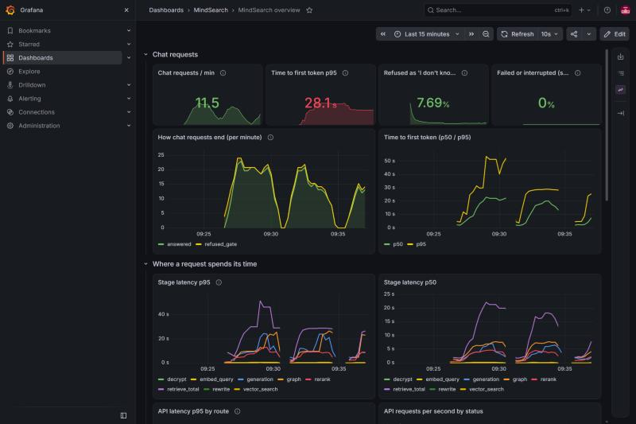

# MindSearch: Enterprise Secure GraphRAG Platform with Local LLMs

[](https://github.com/nitin-dutt/MindSearch/actions/workflows/ci.yml)

[](https://opensource.org/licenses/MIT)
[](https://www.python.org/)
[-purple.svg)](https://github.com/vllm-project/vllm)
[](https://qdrant.tech/)
[](https://neo4j.com/)
[](https://cryptography.io/)

**MindSearch** is an enterprise-grade, 100% offline **GraphRAG (Knowledge Graph + Dense Vector RAG)** platform. Designed for air-gapped, privacy-sensitive environments (finance, legal, defense, healthcare), it removes cloud API dependencies and recurring token costs, and keeps documents on your own hardware.

By fusing **Qdrant dense vector search**, **Neo4j multi-hop knowledge graphs**, **MS-MARCO Cross-Encoder re-ranking**, and local **vLLM-served quantized LLMs**, MindSearch finds the second supporting passage that multi-hop questions need (measured on held-out HotpotQA questions: both needed passages reach the model 87% of the time versus 73% for a dense-only pipeline, see [Multi-hop retrieval](#multi-hop-retrieval-the-graphs-job))—with chunk text stored under **AES-GCM 256-bit encryption** and retrieval filtered by an **organization-configurable access policy** (clearance levels + departments) enforced on both the vector and graph queries. See [Security Model and Limits](#security-model-and-limits) for exactly what is and is not protected.

---

## Table of Contents

- [Core Objectives](#core-objectives)
- [System Architecture](#system-architecture)
- [Project Structure](#project-structure)
- [How It Works (End-to-End Pipeline)](#how-it-works-end-to-end-pipeline)
  - [1. Asynchronous Ingestion & Graph ETL](#1-asynchronous-ingestion--graph-etl)
  - [2. Hybrid GraphRAG Retrieval](#2-hybrid-graphrag-retrieval)
  - [3. Cross-Encoder Noise Filtering](#3-cross-encoder-noise-filtering)
  - [4. Guardrailed Generation](#4-guardrailed-generation)
- [Empirical Metrics & Evaluation](#empirical-metrics--evaluation)
  - [RAGAS Benchmark (SQuAD 2.0 Subset)](#ragas-benchmark-squad-20-subset)
  - [Security & Encryption Latency](#security--encryption-latency)
- [Key Outcomes](#key-outcomes)
- [Security Model and Limits](#security-model-and-limits)
- [Future Roadmap & Next Steps](#future-roadmap--next-steps)
- [Quickstart & Setup](#quickstart--setup)
- [API Reference](#api-reference)

---

## Core Objectives

1. **Eliminate Vector Search Blind Spots (Multi-Hop GraphRAG):** Standard vector search struggles when information is scattered across non-contiguous paragraphs. MindSearch links every entity to the passages that mention it in Neo4j, follows those links from the entities in the question and in the best passages, and ranks the candidates with a small trained ranker (see Multi-hop retrieval below for the measured result and its limits).
2. **Document-Level Security (encryption at rest + policy-driven access control):** Unauthorized text never reaches the LLM prompt, because it is filtered out at the database query level before the prompt is built. Chunk text is AES-GCM-256 encrypted and each ciphertext is bound to its record and access rule; identity comes from signed login tokens.
3. **High-Throughput Offline Inference:** Maximize local GPU hardware utilization via **vLLM** (PagedAttention, Continuous Batching, and AWQ 4-bit quantization) with dual-engine offloading (CPU Ollama for extraction, GPU vLLM for chat).
4. **Asynchronous Non-Blocking Scalability:** Decouple document parsing, embedding, and graph generation into background task queues using **Celery & Redis**.
5. **Continuous Empirical Validation:** Rigorously validate context precision, recall, and faithfulness using an automated offline **RAGAS LLM-as-a-Judge** pipeline.

---

## System Architecture

```
                                  ┌──────────────────────────────┐
                                  │   Streamlit Frontend / API   │
                                  └──────────────┬───────────────┘
                                                 │
                                                 ▼
                                     FastAPI Gateway (Port 8000)
                                      ├── Prometheus Instrumentator
                                      └── Auth & Role Header (RBAC)
                                     /                            \
           [Ingest: Async / Non-Blocking]                    [Chat: Low-Latency Query]
                         │                                                │
                         ▼                                                ▼
             Celery Worker + Redis Queue                       RAG Pipeline Orchestrator
             ├── Chunker (Paragraph-Aware)                                ├── Query Entity Extraction (SpaCy)
             ├── AES-GCM 256-bit Encryptor                                ├── Qdrant Vector Retrieval (RBAC Filter)
             ├── Embedder (all-MiniLM-L6-v2)                              ├── On-The-Fly Decryptor
             └── Graph Builder (Ollama / SpaCy)                           ├── Neo4j Subgraph Extraction (1-2 Hop)
                         │                                                ├── MS-MARCO Cross-Encoder Re-Ranking
                         ▼                                                │   (Scored Dense Chunks + Filtered Triples)
               ┌───────────────────┐                                      └── Structured XML Context Construction
               │  Storage Layer    │                                                 │
               ├───────────────────┤                                                 ▼
               │ Qdrant Vector DB  │ ◄──────────────────────────────────── Local vLLM Inference Engine
               │ (Encrypted Docs)  │                                       (Qwen2.5-7B-Instruct-AWQ)
               ├───────────────────┤                                                 │
               │ Neo4j Graph DB    │ ◄──────────────────────────────────── Streaming Response (SSE)
               │ (Entities/Rel.)   │
               └───────────────────┘
```

---

## Project Structure

```
MindSearch/
├── docker-compose.yml              # Stack: API, vLLM, Neo4j, Redis, Qdrant, Celery worker, UI, Prometheus, Grafana (pinned, health-checked)
├── docker-compose.eval.yml         # Overlay: run against the current source without rebuilding
├── .env.example                    # Secrets template (copy to .env, which is git-ignored)
├── .github/                        # CI workflow (lint, tests, Docker build, audit) and Dependabot config
├── ruff.toml, LICENSE, README.md
├── prometheus/prometheus.yml       # Prometheus scrape configuration
├── samples/                        # Example documents
├── docs/                           # Threat model; archive/ holds the pre-harness evaluation run cited above
│
├── backend/
│   ├── main.py, api.py             # uvicorn entry point; HTTP API: login, chat (SSE), ingest, documents, per-request authorization
│   ├── settings.py                 # Central configuration: every model name, address and knob (35 settings, no secrets)
│   ├── auth.py, access_policy.py   # Signed tokens + scrypt; the one access rule compiled into Qdrant and Neo4j filters
│   ├── org_policy.yaml, org_policies/   # Active policy and example policies (flat, hierarchy, departmental, matrix)
│   ├── manage_users.py, uploads.py, ratelimit.py, audit.py   # Users CLI; safe uploads; login rate limiter; audit log
│   ├── rag_pipeline.py, pipeline_config.py   # Config-driven pipeline and its presets (dense_only ... hybrid_graph_chunks)
│   ├── chunker.py, embedder.py, sparse.py    # Chunking; dense + keyword (BM25-style, keyed ids) vectors in Qdrant
│   ├── retriever.py, reranker.py   # Filtered retrieval, integrity-checked decryption, cross-encoder, dynamic cutoff
│   ├── graph_ranker.py             # Hop-aware ranker (learned weights) for multi-hop questions
│   ├── kg_builder.py, kg_extractors.py   # Entity graph (entity-to-passage links), extraction with cache
│   ├── conversation.py             # Follow-up rewriting and server-side history limits
│   ├── doc_identity.py, doc_registry.py  # Deterministic ids (idempotent ingestion); document registry
│   ├── encryptor.py                # AES-GCM-256, key from environment, ciphertext bound to record + access rule
│   ├── llm.py, worker.py           # vLLM client; Celery ingestion task
│   ├── prepare_large_dataset.py, prepare_hotpot_dataset.py   # Build the SQuAD and HotpotQA evaluation sets
│   ├── evaluation/                 # generate, judge, report, metrics, retrieval_bench, hop_tune, graph_diagnose, calibration, results/
│   ├── loadtest/                   # Concurrency load test and its results
│   ├── tests/                      # 406 automated test cases (access control, auth, API, encryption, graph, metrics)
│   ├── requirements*.txt, constraints.txt, .coveragerc, Dockerfile   # Pinned dependencies, full lock, coverage config
│
└── frontend/
    ├── app.py                      # Streamlit UI: login, upload with access level/groups, documents, chat with sources
    ├── Dockerfile
    └── requirements.txt
```

---

## How It Works (End-to-End Pipeline)

### 1. Asynchronous Ingestion & Graph ETL
1. **Chunking (`chunker.py`):** Ingested documents (PDF, DOCX, TXT, Markdown) are split into passages of about 150 words with 20 words of overlap. Hard-wrapped PDF lines are re-flowed into sentences (and line-end hyphenation is repaired), paragraphs longer than a passage are cut at sentence boundaries, and every PDF passage keeps its page range so sources can say "page 3". Before this, 6-8% of passages exceeded the embedding model's 256-token limit (their tails were never searchable); now 0.2% do. The benchmark corpora (one whole passage per line) are chunked exactly as before (all 12,081 chunks identical), so earlier results are unaffected. Scanned PDFs need OCR, which is not built.
2. **At-Rest Encryption (`encryptor.py`):** Each plaintext chunk is encrypted with **AES-GCM 256-bit** authenticated encryption before disk persistence.
3. **Dense and keyword indexing (`embedder.py`, `sparse.py`):** Chunks become 384-dimensional dense vectors (`all-MiniLM-L6-v2`) and BM25-style keyword vectors. Both, the encrypted ciphertext and the document's access rule (level, groups, users) are stored in **Qdrant**.
4. **Knowledge Graph Extraction (`kg_builder.py`):** Subject-relation-object facts are extracted by an LLM (Ollama or the vLLM model), named entities are also found directly in the text with spaCy, and everything is written to **Neo4j**: `Entity` nodes, relationship edges, and `MENTIONED_IN` links from each entity to the passages that mention it (plus passage titles as the "page" of an entity). Every edge carries the document's access rule.
5. **Background Task Execution (`worker.py`):** FastAPI dispatches ingestion tasks directly to **Celery** via **Redis**, guaranteeing zero API request blocking or upload timeouts.

### 2. Hybrid GraphRAG Retrieval
When a user submits a query:
- **Hybrid Retrieval:** The query is matched two ways inside Qdrant: by meaning (dense embedding) and by exact words (a BM25-style keyword vector), and the two rankings are fused with Reciprocal Rank Fusion. Keywords catch names, identifiers and numbers that embeddings blur. A filter generated from the organization's access policy (user's level and groups vs. the document's minimum level and groups) is applied inside the Qdrant query, so unauthorized chunks are never returned. The same rule filters every hop of the Neo4j graph traversal.
- **On-the-Fly Decryption:** Retrieved ciphertext chunks are decrypted in-memory into plaintext.
- **Graph-guided passage hops:** The graph links every entity to the passages that mention it. Entities named in the question and entities found in the best passages (the bridge) lead to other passages, and a hop-aware ranker picks the final four. The same access rule filters every graph step and the passage fetch from Qdrant.

### 3. Cross-Encoder Noise Filtering
Raw graph queries often retrieve true-but-tangential facts that degrade answer precision. MindSearch passes both the decrypted document chunks and the graph triples through a **Cross-Encoder (`cross-encoder/ms-marco-MiniLM-L-6-v2`)**:
- Assigns direct semantic relevance scores to `[query, chunk]` and `[query, graph_fact]` pairs.
- Trims off-topic relationships, retaining the 3 highest-relevance graph facts and up to 3 document passages (fewer when the lower ones score far below the best, see the dynamic context cutoff below).

### 4. Guardrailed Generation
The filtered context is structured using explicit XML boundary tags:
```xml
Context:
<doc id="1">Document passage 1...</doc>
<doc id="2">Document passage 2...</doc>
<kg_fact>EntityA -> RELATION -> EntityB</kg_fact>

Question:
What are the requirements for deployment?
```
- **Inference Server:** Prompt is dispatched to **vLLM** serving `Qwen/Qwen2.5-7B-Instruct-AWQ` at `temperature=0.1`.
- **System Instructions:** The production prompt confines the model to the numbered passages, asks it to cite them as `[1]`, `[2]`, to combine several documents when a question needs it, and to answer with one fixed "I don't know" sentence when the documents do not contain the answer (see Citations and "I don't know" below). The original 1-2 sentence prompt is kept as the `benchmark` profile so earlier results stay reproducible.
- **Streaming:** Tokens stream back in real-time via Server-Sent Events (SSE).

---

## Empirical Metrics & Evaluation

Every number in this section is produced by a script in this repo and stored in a result file under
`backend/evaluation/results/` (or `docs/archive/` for the pre-harness run). Nothing is hand-entered.
Open issues and planned work are listed under [Future Roadmap](#future-roadmap--next-steps).

### How evaluation works

| Stage | Script | What it measures | Needs an LLM judge? |
| :--- | :--- | :--- | :---: |
| Pass 1 | `evaluation/generate.py` | Retrieval: Recall@k, Hit@k, MRR, nDCG@k, full-support@k (all hops found). Answers: contains-gold, token recall. Graph coverage, latency. | No |
| Pass 2 | `evaluation/judge.py` | RAGAS: context precision, context recall, faithfulness, answer relevancy | Yes (separate model) |
| Report | `evaluation/report.py` | Tables with 95% bootstrap CIs and paired differences between configs | No |

- **Judge-free retrieval metrics are exact**: each question stores its gold passage(s), and a retrieved chunk counts only if it contains that passage text.
- **Ablation configs** (`pipeline_config.py`): `dense_only`, `dense_rerank`, `full` (dense + rerank + knowledge graph).
- **Clean index per run**: evaluation uses its own Qdrant index and encryption key (`qdrant_eval/`), rebuilt only when the corpus, chunking or embedder changes.
- **Two datasets**: SQuAD v1.1 (single-hop control) and HotpotQA distractor (multi-hop, where the graph is supposed to help).
- **Independent judge**: the 8 GB GPU cannot hold two models, so generation and judging are separate passes. `judge.py` stamps `self_judged: true` if the judge model equals the generator.

```bash
# from backend/
python prepare_large_dataset.py && python prepare_hotpot_dataset.py
python -m evaluation.generate --dataset squad  --config dense_only
python -m evaluation.generate --dataset squad  --config dense_rerank
python -m evaluation.generate --dataset hotpot --config hybrid_graph_chunks --reset-graph   # WIPES the connected Neo4j
python prepare_hotpot_dataset.py --name hotpot_b --skip 200 --n 100        # the untouched held-out multi-hop set
python -m evaluation.retrieval_bench --dataset squad_dev_xl --models all-MiniLM-L6-v2   # embedder / hybrid comparison
python -m evaluation.judge --run-dir evaluation/results/<run_id> --judge-model <model> --judge-url <vLLM URL>
python -m evaluation.report "evaluation/results/squad__*" --baseline dense_only
```

### Results: SQuAD v1.1 held-out test set (n=100, generator Qwen2.5-7B-AWQ)

Judge-free metrics (exact; mean, 95% bootstrap CI in the result files):

| Config | Recall@3 | MRR | Answer contains gold | Exact context precision | Context words |
| :--- | :---: | :---: | :---: | :---: | :---: |
| dense only | 0.970 | 0.900 | 0.860 | 0.323 | 397 |
| + cross-encoder rerank | **1.000** | **0.967** | **0.880** | 0.333 | 410 |
| + rerank, dynamic context | 0.990 | 0.962 | **0.900** | **0.910** | **158** |
| + rerank, dynamic context, 10 candidates ("fast") | 0.990 | 0.968 | 0.890 | **0.910** | **156** |
| + rerank + knowledge graph | 1.000 | 0.967 | 0.870 | n/a (run predates the metric) | n/a |

RAGAS, scored by an **independent judge** (Llama-3.1-8B-Instruct-AWQ, a different model family from the generator; mean with 95% CI):

| Config | Context precision | Context recall | Faithfulness | Answer relevancy |
| :--- | :---: | :---: | :---: | :---: |
| dense only | 0.921 (0.88-0.96) | 0.881 (0.83-0.93) | 0.792 (0.74-0.85) | 0.770 (0.73-0.81) |
| + rerank | **0.965** (0.94-0.99) | 0.879 (0.83-0.93) | 0.794 (0.74-0.84) | 0.776 (0.74-0.82) |
| + rerank, dynamic context | 0.977 (0.95-0.99) | 0.867 (0.81-0.92) | 0.809 (0.76-0.86) | 0.791 (0.75-0.83) |
| + rerank, dynamic context, 10 candidates ("fast") | **0.983** (0.96-1.00) | 0.868 (0.81-0.92) | 0.833 (0.79-0.88) | 0.796 (0.76-0.83) |
| + rerank + graph facts (earlier, facts-only graph; superseded, see Multi-hop retrieval) | 0.840 (0.81-0.87) | 0.872 (0.82-0.92) | **0.871** (0.82-0.92) | 0.790 (0.75-0.83) |

What the paired per-question comparisons show (95% CI excludes 0 unless noted):
- **Reranking helps:** +0.067 MRR (exact), +0.035 RAGAS precision. Recall@3 reaches 1.00. It costs about 300-400 ms per query on CPU.
- **Dynamic context keeps quality and cuts cost.** The reranker's score decides how many passages to send (the best one plus any within 4 points of it), tuned on a separate dev set. Context drops from 410 to about 157 words and exact precision rises from 0.33 to 0.91, with answer correctness unchanged (contains-gold 0.88 to 0.90) and recall@3 0.99 vs 1.00 (one question). Paired RAGAS differences vs rerank-only: precision +0.012 ("dynamic") and +0.019 ("fast"), significant; recall, faithfulness and relevancy unchanged within noise. Speed (same session): retrieval about 310 ms to about 125 ms for the 10-candidate "fast" preset, and answer generation 1,678 ms to 762-886 ms because the prompt is shorter. The "fast" preset costs about 0.012 recall on the dev set.
- **The graph changes judged faithfulness and precision, not correctness.** Versus rerank-only: faithfulness +0.077 (CI +0.022 to +0.134), precision -0.124, while recall, relevancy and answer correctness do not move (contains-gold -0.01, CI -0.06 to +0.03). Graph facts contained the gold answer for 36 of 100 questions, but the retrieved passages already contained it. SQuAD is single-hop, so it cannot show a graph benefit; a multi-hop benchmark (HotpotQA) is the intended test and is not run yet.
- **RAGAS faithfulness is pessimistic here.** We hand-labelled 30 answers: humans judged 93% correct and 93% fully supported by the retrieved passage, while the 8B judge's faithfulness is 0.79. The judge agreed with the human 'supported' label on only 50% of items (it flagged 15 supported answers as unsupported and never passed a bad one). Treat the RAGAS numbers as a conservative lower bound, and trust differences between configs only where answer correctness agrees (the graph's judged-faithfulness gain does not coincide with any gain in correctness).
- **Retrieval is saturated on this set:** the gold passage is already in the top 3 for 97% of questions before reranking. The harder 400-question dev set (`squad_dev`, used for tuning, never reported) has more headroom.

An earlier version of this README showed 0.9695 / 1.000 and a "vector-only baseline"; neither could be reproduced and both were removed. The earlier self-judged run (judge = generator) gave precision 0.50, a reminder of how much the judge model matters.

Reproduce: `python -m evaluation.generate --dataset squad --config <dense_only|dense_rerank|full>` then `python -m evaluation.judge --run-dir <dir> --judge-model <model>`; raw files are in `backend/evaluation/results/`.

### Hybrid retrieval and the embedder choice

SQuAD questions over a small corpus are almost too easy to retrieve (the 700-passage dev corpus already gives recall@3 near 1.0), which hides differences between retrieval methods. So the retrieval comparisons use the same 400 dev questions over a **10,000-passage corpus** (`squad_dev_xl`: every validation passage plus seeded training passages as distractors). Metrics are exact (the gold passage must be in the top k; no LLM judge); `python -m evaluation.retrieval_bench` reproduces the table.

| 400 dev questions, 9,348 chunks | hit@1 | hit@3 | recall@20 |
| :--- | :---: | :---: | :---: |
| MiniLM dense only (previous retriever) | 0.570 | 0.740 | 0.892 |
| BM25 keywords only | 0.715 | 0.838 | 0.943 |
| MiniLM + BM25, fused (RRF) | 0.660 | 0.853 | 0.970 |
| e5-base-v2 dense (best of 6 embedders tested) | 0.725 | 0.858 | 0.953 |
| e5-base-v2 + BM25 | 0.772 | 0.892 | 0.978 |

The pipeline always re-scores the candidates with the cross-encoder, and that is the number that matters. Measured through the real Qdrant pipeline (paired, same questions):

| Final retrieval (after rerank) | dense (before) | **hybrid (now)** | difference (95% CI) |
| :--- | :---: | :---: | :---: |
| hit@1 | 0.790 | **0.848** | +0.058 (+0.035 to +0.083) |
| hit@3 (what the model sees) | 0.858 | **0.927** | +0.070 (+0.045 to +0.098) |
| MRR | 0.822 | **0.885** | +0.063 (+0.041 to +0.088) |
| candidate pool recall@20 | 0.892 | **0.975** | +0.083 (+0.058 to +0.113) |

With the dynamic cutoff on top (`hybrid_rerank_dynamic`) the same gain holds and exact context precision rises from 0.29 to 0.73 with about half the context words. On the frozen test set (100 questions, a small and easy corpus) hybrid is neutral to slightly positive (recall@3 before rerank 0.970 to 1.000; unchanged after), as expected when there is little to improve.

**A stronger embedder was tested and rejected.** After hybrid search plus the reranker, e5-base-v2 and e5-small-v2 are statistically identical to MiniLM (difference +0.000, CI -0.007 to +0.007), while embedding about 6.5x (base) slower on CPU, so MiniLM stays. Costs: hybrid adds about 120 ms p50 retrieval latency in this single-process embedded benchmark, and the index stores one extra sparse vector per chunk.

### Multi-hop retrieval (the graph's job)

A single-hop question (SQuAD) needs one passage, so a graph cannot help; a multi-hop question needs two linked passages, and the second does not look like the question ("What is the school where the Wilmslow Show is held designated as?": the answer sits in the school's own page). Evaluated on HotpotQA (distractor setting, 2 supporting passages per question), with a pipeline that fails here when both are not in the context.

**What the graph does.** At ingestion, every passage is linked to the entities it mentions (entities from LLM-extracted facts, named entities found directly in the text, and the passage's own leading title as the "page" of that entity). At query time the entities named in the question and those of the top passages (the bridge) lead to other passages; the cross-encoder score is combined with graph signals (how many question entities a passage covers; whether it is the page of a question entity or of a bridge entity) by a small logistic-regression ranker (`graph_ranker.py`, 5 weights, plain arithmetic at query time). Four passages are sent to the model instead of three.

**Result on 100 held-out questions** (`hotpot_b`: never used to build, tune or choose anything; judge-free, paired bootstrap 95% CIs, `evaluation/results/hotpot_b__*`):

| Pipeline | Both supporting passages in context | Answer contains gold |
| :--- | :---: | :---: |
| Dense + rerank, 3 passages (previous pipeline) | 0.730 | 0.630 |
| Hybrid + rerank, 3 passages | 0.750 | 0.640 |
| Hybrid + rerank, 4 passages (fair baseline) | 0.790 | 0.640 |
| **Hybrid + graph-guided hops, 4 passages (default)** | **0.870** | **0.680** |

Against the fair baseline at the same four passages: both-passages-in-context **+0.080 (CI +0.030 to +0.140)**, answer contains-gold **+0.040 (CI +0.010 to +0.080)**. Against the previous pipeline: **+0.140 (CI +0.080 to +0.210)** on retrieval; the answer gain (+0.050, CI -0.010 to +0.120) is positive but not conclusive. Putting the graph's facts (triples) into the prompt as well adds nothing, so the default sends passages only.

**Honest limits.**
- With perfect retrieval this generator reaches 0.81 answer contains-gold on this benchmark (`evaluation/oracle_ceiling.py`), so answer scores are capped well below retrieval scores; the gap from 0.68 to 0.81 is partly the model, partly the remaining retrieval misses.
- The ranker's weights were fitted on a separate 200-question HotpotQA sample (5-fold cross-validated there: 0.700 to 0.765 at three passages, 0.795 to 0.880 at four). The numbers above are on fresh questions and agree with those estimates.
- The "page" signal uses a passage's leading title, as encyclopedia-style corpora have. For documents without titles or headings it contributes nothing and the rest of the ranker still applies; this is untested on such documents.
- It was a negative result first: an earlier graph (facts only, matched by substring) gave no gain at all (answer contains-gold 0.655 to 0.625). The fix came from stage-by-stage diagnosis (`evaluation/graph_diagnose.py`): the missing passage was usually already a candidate, and the problem was ranking, not finding.
- A dynamic context cutoff tuned on single-hop SQuAD hurts multi-hop badly (both passages 0.700 to 0.505), so it is off in the multi-hop presets. For single-hop workloads use `hybrid_rerank_dynamic`.
- Not yet measured: this graph pipeline on single-hop corpora; an independent-judge (RAGAS) score of the multi-hop answers.

### Citations and "I don't know"

An answer you cannot check, or a confident answer to a question the documents never address, is worse than no answer. Two mechanisms address that, both measured.

**Citations.** Every passage in the prompt is numbered (`<doc id="2">`), the model is told to cite the passages it used as `[2]`, and the chat stream's final `sources` event lists them with their number, file name and PDF page; the `cited` flag marks the ones the answer actually used. The server reads the `[n]` markers back out of the answer and checks that each number exists (an invented `[9]` is logged and not trusted). An answer that says "I don't know" lists no sources.

**"I don't know", in two layers.** (1) The prompt instructs the model to reply with one exact sentence when the combined documents do not contain what is needed. (2) A refusal *gate* runs before the model is called: if the best passage's cross-encoder score is below -9.0, the system answers "I don't know" itself (it was -6.0 until 2026-10-22; see the note under the table). The gate is on in the default preset (`hybrid_graph_chunks`) and off in the benchmark presets, so ablations stay comparable.

**How it was measured.** A benchmark of unanswerable questions was built from SQuAD (`prepare_unanswerable.py`): for about half of the answer passages, the passage is removed from the index while related passages (same article) stay, so a system that answers from loosely related text is caught. The gate's threshold was chosen on the dev version (`squad_dev_unans`; rule: refuse as many unanswerable questions as possible while wrongly refusing at most 5% of valid ones; the best passage's score separates the two groups with AUC 0.964), the prompt was revised once on dev and multi-hop tuning data, and the numbers below are from a **fresh set of 200 questions (98 unanswerable, 102 answerable) that played no part in any decision** (`squad_unans_b`). Judge-free, 95% bootstrap CIs.

| 200 fresh questions | Old prompt (no way to refuse) | New prompt | New prompt + gate at -6.0 | New prompt + gate at -9.0 (default) |
| :--- | :---: | :---: | :---: | :---: |
| Says "I don't know" when it should (98 unanswerable) | **0.0%** (answered all 98: every answer made up) | **89.8%** (83.7-94.9) | **92.9%** (86.7-96.9) | **89.8%** (83.7-94.9) |
| Wrongly refuses a valid question (102) | 0.0% | 3.9% (1.0-7.8) | 4.9% (1.0-9.8) | 4.9% (1.0-9.8) |
| Non-refused answers that cite a valid passage | n/a | 100% | 100% |
| Cited passages that really contain the answer passage | n/a | 91.3% | 89.5% |
| Answer correct (contains-gold) on answerable | 0.843 | 0.804 | 0.804 |

At -6.0 the gate alone refused 57% of the unanswerable questions (56 of 98) without calling the model at all, and refused none of the valid ones; at -9.0 it refuses 33% on its own and the model's own "I don't know" does the rest.

**Why the cutoff moved from -6.0 to -9.0 (2026-10-22).** In real use on a job-description PDF, a short question ("what is the package") was refused although the passage with the answer had been retrieved: the cross-encoder scored the best passage -8.8, while clearly off-topic questions scored about -11, so -6.0 (tuned on Wikipedia-style SQuAD text) was too strict there. Measured on the dev set (400 questions) with the same prompt: -6.0 refuses 90.0% of unanswerable questions and wrongly refuses 2.1% of valid ones; -9.0 refuses 86.1% and wrongly refuses 1.0%; with no cutoff at all 85.6% and 1.0% (the prompt does most of the refusing). On the fresh set above the false-refusal rate is the same at both cutoffs (4.9%) and the refusal rate is 3 points lower at -9.0, a difference inside the confidence intervals. HotpotQA answers were unchanged (contains-gold 0.62 at -6.0, 0.61 at -9.0). So -9.0 trades a little refusal strength for fewer wrongly refused short questions on real documents; it was chosen for that case and has no benchmark of real enterprise documents behind it yet. When the new system does answer, it is right as often as before (0.837 vs 0.843), and the drop in overall accuracy (-0.039, CI -0.088 to +0.010) is not statistically significant: it is the price of refusing instead of guessing.

**Honest limits.**
- **Multi-hop costs more.** On the 100 held-out HotpotQA questions the new prompt plus gate refuses 12; in 10 of those both needed passages were in the context, so about 10% of valid multi-hop questions are wrongly refused (the gate itself refused none). The first prompt version refused 21% and was revised to tell the model to combine documents. Answer accuracy moves 0.680 to 0.650 (-0.030, CI -0.090 to +0.030, not significant). Part of that drop is the model no longer guessing: when a needed passage was missing from the context, the old prompt was right only 31% of the time.
- Citation checks catch invented numbers, not subtle misattribution (a real number on a wrong sentence); about one in ten cited passages did not contain the answer passage.
- The gate's threshold was calibrated on SQuAD-style text with this cross-encoder; a different corpus or reranker needs it re-tuned (`python -m evaluation.tune_abstain`). Detection of "I don't know" is deliberately strict (the exact sentence, or an answer starting with "I don't know").
- The unanswerable questions are constructed (answer passage removed), not written by people to look answerable as in SQuAD 2.0, so real-world refusal quality may differ.

### Observability

The API (`/metrics`), the ingestion worker (port 9100) and vLLM are scraped by Prometheus every 5 seconds, and Grafana starts with the data source and the **MindSearch overview** dashboard already loaded (`grafana/provisioning`, `grafana/dashboards`; no clicking). Open `http://localhost:3000` (user `admin`, password from `GRAFANA_ADMIN_PASSWORD`, default `admin`; the port is bound to this machine only).



What the pipeline metrics (`backend/metrics.py`) record:

| Metric | What it tells you |
| :--- | :--- |
| `mindsearch_stage_seconds{stage}` | Time in each stage of a chat request: `rewrite`, `embed_query`, `vector_search`, `decrypt`, `rerank`, `graph`, `retrieve_total`, `generation` |
| `mindsearch_time_to_first_token_seconds` | From the request arriving to the first word being ready |
| `mindsearch_chat_requests_total{outcome}` | How requests end: `answered`, `abstained_model`, `refused_gate`, `no_context`, `failed` (HTTP 503), `interrupted` |
| `mindsearch_decrypt_failures_total`, `mindsearch_invalid_citations_total` | Integrity and citation problems (should stay at 0) |
| `mindsearch_ingest_documents_total{status}`, `..._chunks_total`, `..._seconds`, `mindsearch_kg_chunks_failed_total` | Worker: documents done / failed / retried, chunks written, time per document, graph extraction failures |

Labels are a small fixed set (never a user, query or document id), so the number of time series cannot grow with traffic and nothing sensitive leaks into metrics. `python grafana/build_dashboard.py` regenerates the dashboard JSON from one-line panel definitions.

**What it showed on the first real run** (default preset, 1 to 10 concurrent simulated users, one machine): the model and the vector search are not the bottleneck. Averaged over the run, a request spent about 0.14 s embedding the question, 0.03 s in the vector search, 3.3 s in the cross-encoder re-ranking and 5.2 s in the graph stage (which re-ranks the larger candidate pool a second time), against about 4.2 s generating the answer. Time to first token was 1.7 s with one user, 8.9 s with five and 24 s with ten. **So the default (graph-aware, 4-passage) preset is much slower under load than the dense presets measured in the Concurrency section above;** the likely fixes (re-rank once instead of twice, a smaller candidate pool, more CPU workers) are not done yet. This was an observability check, not a benchmark: no controlled before/after was run.

### Follow-up questions (multi-turn chat)

A follow-up like "what about its price?" means nothing to a search engine that cannot see the chat. The server rewrites it into a standalone question using the recent history ("What is the price of the Contoso acquisition?") and retrieves with that; the UI shows it as "Searched for: ...". Limits are enforced on the server: the rewriter sees at most the last 6 messages (3 turns) and the answer model the last 4 (2 turns), both capped at about 700 tokens, with old answers shortened to 600 characters (all configurable: `HISTORY_MAX_MESSAGES`, `HISTORY_GENERATION_MESSAGES`, `HISTORY_TOKEN_BUDGET`, `HISTORY_PER_MESSAGE_CHARS`). Client-supplied `system` messages are dropped, and history never affects access control.

Measured on 332 synthetic follow-up chats from the SQuAD dev set (`python -m evaluation.followup`; retrieval metrics are exact, no LLM judge):

| Query used for retrieval | Recall@3 | MRR |
| :--- | :---: | :---: |
| Original standalone question (upper bound) | 0.958 (0.937-0.979) | 0.938 |
| **Raw follow-up, no rewriting** | **0.777** (0.732-0.819) | 0.720 |
| Follow-up rewritten from history | **0.952** (0.928-0.973) | 0.931 |

Rewriting raises recall@3 by +0.175 (95% CI +0.136 to +0.217) and is statistically indistinguishable from the original question (difference 0.006, CI -0.015 to +0.027). The rewrite costs about 250 ms (p50; p95 370 ms) once per follow-up and is skipped for a first question. Caveats: the same model writes the test follow-ups and performs the rewrite, and some generated follow-ups drift slightly in meaning, so treat this as a strong sanity check rather than a final benchmark. If the rewrite fails or times out, the original question is used.

### Concurrency and load

Measured with `python -m loadtest.chat_load` (closed-loop simulated users, each sending 4 chat requests; SQuAD questions over an 87-chunk index; Qwen2.5-7B-AWQ on vLLM; RTX 5070 Laptop 8 GB, Ryzen 9 8940HX). Raw results are in `backend/loadtest/results/`. Each cell is **p95 time-to-first-token / throughput**.

| Users | Before: retrieval blocked the event loop | Retrieval in a capped thread pool (INF-02) | Thread pool + "fast" preset (10 candidates, dynamic context, no graph) |
| :--- | :---: | :---: | :---: |
| 1 | 963 ms / 0.99 req/s | 663 ms / 1.18 req/s | **322 ms / 1.62 req/s** |
| 5 | 3,432 ms / 1.65 req/s | 2,523 ms / 2.02 req/s | **893 ms / 4.62 req/s** |
| 10 | 7,084 ms / 1.38 req/s | 4,098 ms / 2.01 req/s | **1,729 ms / 6.24 req/s** |
| 20 | 35,249 ms / 1.15 req/s | 8,195 ms / 2.25 req/s | **3,006 ms / 5.39 req/s** |

A trivial `/healthz` endpoint is probed every 100 ms during each run. Its slowest answer shows whether the server is frozen: **549 / 1,103 / 4,537 / 6,710 ms** before (at 1 / 5 / 10 / 20 users) versus **4 / 19 / 43 / 47 ms** with the thread pool.

What this does and does not show:
- **Before the fix, throughput fell as users were added** (1.65 to 1.15 req/s) because every retrieval froze the server's event loop. Retrieval now runs in worker threads (`RETRIEVAL_WORKERS`, default 4), and the artificial 10 ms sleep per streamed token was removed.
- **Median time-to-first-token is not always better with the thread pool alone** (for example 6.6 s vs 2.4 s at 20 users): the old server was unfair, letting some requests through quickly while others stalled for tens of seconds. Requests now wait in line. The tail (p95) is much better in every row.
- **The remaining limit is CPU, not threads.** One retrieval already uses all cores, so more workers add little throughput; making each retrieval cheaper (the "fast" preset) is what raises it. That preset skips the knowledge graph, which showed no benefit on single-hop SQuAD. Select a preset with `PIPELINE_PRESET` (default `hybrid_graph_chunks`: hybrid retrieval plus graph-guided passage hops; see Multi-hop retrieval below). The load-test numbers above were measured with the dense presets.
- **Ingestion is idempotent:** uploading the same document twice, or a task retry after a partial failure, overwrites instead of duplicating (deterministic document and chunk ids).

### Security & Encryption Latency

Produced by `python backend/benchmark_security.py` (2000 iterations after warm-up, single thread, AES-GCM-256):

| Chunk size | Encrypt p50 | Decrypt p50 | Throughput (p50) |
| :--- | :---: | :---: | :---: |
| 300 chars | 0.0009 ms | 0.0009 ms | ~1.1 M chunks/s |
| 600 chars | 0.0010 ms | 0.0010 ms | ~1.0 M chunks/s |
| 1200 chars | 0.0013 ms | 0.0011 ms | ~0.8-0.9 M chunks/s |

Hardware: AMD Ryzen 9 8940HX, Python 3.11.7, Windows 11. Encryption cost is negligible next to embedding, reranking and LLM generation.

---

## Key Outcomes

> **Status:** security claims are verified by automated tests, including attack tests; limits are listed under [Security Model and Limits](#security-model-and-limits). The multi-hop claim is now measured on a held-out set (see Multi-hop retrieval, with its limits). Observability is implemented and was verified live with real traffic (see Observability). Distributed tracing is not built.

- 🛡️ **Policy-driven access control, verified:** one access rule (clearance levels + departments + super roles, defined per organization in `org_policy.yaml`) is compiled into both the Qdrant filter and the Neo4j filter. An exhaustive test checks every user against every document ACL for five organization structures and confirms both databases return exactly what the rule allows. Chunk text is AES-GCM-256 encrypted with a key kept outside the data, and ciphertext is bound to its record and ACL so database tampering cannot widen access. Limits (for example plaintext graph entity names, no built-in TLS) are listed under [Security Model and Limits](#security-model-and-limits).
- ⚡ **Zero Token Costs & Complete Data Sovereignty:** 100% offline pipeline running on local NVIDIA GPUs. No confidential data ever leaves the on-premises perimeter.
- 🧠 **Multi-hop retrieval via a knowledge graph:** both supporting passages reach the model for 87% of 100 held-out HotpotQA questions versus 73% for the previous dense pipeline (+14 points, 95% CI +8 to +21) and 79% for a hybrid baseline with the same four passages (+8 points, CI +3 to +14). Answer accuracy rises less (0.63 to 0.68; the model's ceiling with perfect passages is 0.81).
- 📈 **Observability:** per-stage timings of every chat request (question embedding, vector search, decryption, re-ranking, graph hop, model), how each request ended (answered, refused, failed ...), ingestion counters, and an auto-provisioned Grafana dashboard; see [Observability](#observability).

---

## Configuration

Every model name, service address, path and tuning knob is defined once in `backend/settings.py`, with its default and the environment variable that overrides it (for example `GENERATOR_MODEL`, `EMBEDDING_MODEL`, `RERANKER_MODEL`, `QDRANT_URL`, `PIPELINE_PRESET`, `RETRIEVAL_WORKERS`, `HISTORY_*`). The API, the Celery worker and the evaluation harness all read it, and each evaluation run saves the settings it ran with in `meta.json`, so a result can be traced back to its configuration. Secrets (database password, token-signing secret, data-encryption key) are kept out of that object on purpose and are read only where they are used, so dumping the configuration can never leak them. A test fails the build if a model name is hard-coded anywhere else. Note that changing `EMBEDDING_MODEL` requires re-indexing the documents.

## Security Model and Limits

**What is protected**
- **Identity:** callers log in and receive a signed token (HS256 JWT); the role is never taken from a client header. Failed logins are rate limited and every login, upload, denial and chat is written to an audit log (queries stored as a hash, not text).
- **Access control:** one rule (clearance level + departments + super roles, from `org_policy.yaml`) is compiled into both the Qdrant filter and the Neo4j filter, and every hop of a graph traversal is checked. Exhaustive tests confirm both stores return exactly what the rule allows.
- **Encryption at rest:** chunk text is AES-GCM-256 encrypted with a key supplied through the environment (never generated or stored next to the data). Each ciphertext is bound to its record and access rule, so editing the database to widen access, or copying restricted ciphertext onto a public record, makes decryption fail.
- **Uploads:** filenames are never used as paths; type, size and file signature are checked; the plaintext upload is deleted after ingestion.
- **Exposure:** Redis, Neo4j and vLLM are bound to localhost; secrets live in `.env`.

**What is NOT protected (stated plainly)**
- Entity names, relationship names and the entity-to-passage links in Neo4j are stored in plaintext (each link carries the document's access rule and is checked on every graph step) (protected by access filters and Neo4j login, not encryption). Embeddings are not encrypted. The keyword index stores, per chunk, keyed hashes of its distinct words (the key is derived from the data key, so a stolen database cannot be matched against a word list), but it still reveals how many distinct terms a chunk has and which chunks share terms.
- There is no TLS in this repository: put a reverse proxy with HTTPS in front before exposing it beyond a trusted network.
- A super role sees everything; its activity is audited, not blocked.
- Hostile text inside a document the user is allowed to read can still mislead the model (prompt injection through permitted content).
- The login rate limiter and audit log are per-process and local; production needs a shared store and an append-only log destination. `/metrics` is unauthenticated (counters only).

It is accurate to say access to documents is enforced in the database queries and chunk text is encrypted at rest. It is not accurate to say exfiltration is impossible or that everything is encrypted.

---

## Future Roadmap & Next Steps

Planned next steps (items marked *done in v2* have already shipped):

### Phase 1: Ingestion Optimization & OCR Fallback
- **Neo4j `UNWIND` Batch Ingestion (done in v2):** Transition from single-transaction Cypher insertions to parameterized batch `UNWIND` queries to accelerate Knowledge Graph construction by **10x–50x**.
- **Automated OCR Fallback:** Detect image-only and low-character PDF uploads and dynamically route them through **Tesseract OCR** before chunking.
- **Entity lookup (done in v2):** `CONTAINS` string scans were replaced by exact, indexed entity keys.

### Phase 2: Enterprise Identity & Granular Multi-Tenant RBAC
- **Done in v2:** token-based login, organization-configurable access policy applied to both vector and graph retrieval, upload hardening, audit log, rate limiting. **Remaining:**
- **Identity Provider Integration:** Connect to on-premises **Keycloak / Active Directory / LDAP** for SSO authentication.
- **Admin Security Console:** Deploy a Next.js/React management console allowing administrators to multiselect security clearance tags (`[Level 1, HR, Legal, Exec]`) on upload.

### Phase 3: Multimodal RAG (Charts, Tables & Diagrams)
- **Visual Element Extraction:** Use PyMuPDF to extract embedded charts, diagrams, and figures during ingestion.
- **VLM Semantic Captioning:** Route images to lightweight local Vision-Language Models (e.g., `moondream2` or `LLaVA` via Ollama) to generate searchable text summaries stored in Qdrant.
- **Inline Visual Rendering:** Pass image source identifiers back to the chat UI to display original diagrams alongside text answers.

### Phase 4: CI/CD Quality Gates & Evaluation Pipelines
- **CI (done in v2):** GitHub Actions runs lint, the full test suite against real Neo4j and Qdrant (88% coverage, floor 80%), a Docker build and a dependency audit on every push; Dependabot keeps pins fresh. **Remaining:**
- **Automated RAGAS Regression Tests:** Integrate evaluation runs into CI/CD pipelines to block releases if Answer Relevancy or Faithfulness degrades below established thresholds.
- **Dedicated Judge LLMs (partly done in v2: the judge is a separate model run in a separate pass):** Decouple evaluation onto specialized grading models (e.g., `Prometheus-2` or `Patronus`) to prevent judge workloads from contending for serving VRAM.

### Phase 5: Distributed Tracing & APM
- **OpenTelemetry Instrumentation:** Instrument all critical stages (PyMuPDF, Qdrant lookup, Neo4j traversal, Cross-Encoder scoring, vLLM inference) with OpenTelemetry spans.
- **Jaeger / Grafana Telemetry:** Export distributed traces to inspect millisecond breakdowns for every single user request.

---

## Quickstart & Setup

### Prerequisites
- Docker & Docker Compose
- NVIDIA GPU with CUDA drivers installed. Developed and measured on an 8 GB RTX 5070 Laptop GPU (one quantized 7B model at a time)
- [NVIDIA Container Toolkit](https://docs.nvidia.com/datacenter/cloud-native/container-toolkit/latest/install-guide.html) configured

### 1. Clone the Repository
```bash
git clone https://github.com/nitin-dutt/MindSearch.git
cd MindSearch
```

### 2. Configure secrets and create a user
```bash
cp .env.example .env            # then fill it in; compose refuses to start without it
python -c "import secrets; print(secrets.token_urlsafe(48))"    # -> MINDSEARCH_JWT_SECRET
python backend/encryptor.py new-key                              # -> MINDSEARCH_DATA_KEY (back this up!)
python backend/manage_users.py add alice --level Manager --roles Admin   # prompts for a password
```
Levels, departments and super roles come from `backend/org_policy.yaml`. Ready-made policies for other organization shapes (flat startup, bank-style hierarchy, departmental enterprise, matrix org) are in `backend/org_policies/`.

### 3. Launch with Docker Compose
```bash
docker compose up --build
```
Every image and Python package version is pinned (`docker-compose.yml`, `backend/requirements*.txt`, `backend/constraints.txt`), so a build today matches the one that was measured. Each service has a health check and `depends_on` waits for it, so the API only starts once Redis, Neo4j, Qdrant and the model server are really ready (the first start downloads the model and takes several minutes). Memory limits are set per service. On Windows, Docker Desktop gets only half of the machine's RAM by default; the full stack (about 11 GB in use with the model loaded) is more comfortable with an explicit limit in `%UserProfile%\.wslconfig`, e.g. `[wsl2]` / `memory=24GB`, followed by `wsl --shutdown`.

Sign in at the UI with the user you created. This starts (infrastructure ports listen on localhost only):
- **FastAPI Gateway:** `http://localhost:8000`
- **Streamlit UI:** `http://localhost:8501`
- **Neo4j Browser:** `http://localhost:7474`
- **vLLM Engine:** `http://localhost:8001`
- **Prometheus:** `http://localhost:9090`
- **Grafana:** `http://localhost:3000`

### Tests and CI
Every push and pull request runs `.github/workflows/ci.yml`: lint (`ruff`), the full pytest suite against real Neo4j and Qdrant service containers with a coverage report, a Docker build of both images with an import smoke test, and a `pip-audit` of the pinned dependency lock (it fails on any new advisory; three advisories that have no fixed release yet are ignored by name in the workflow). Dependabot (`.github/dependabot.yml`) opens weekly pull requests for Python packages, base images, compose images and the workflow's own actions, so each update is tested before it is merged. The suite measures 88% line coverage of the application code (`backend/.coveragerc` excludes tests, evaluation scripts and one-off tools), and CI fails if it drops below 80%. A dry run of these exact steps on a clean Linux container passed all 406 tests, and the API image is about 3.0 GB (it was 11.5 GB before CPU-only torch). To run the same checks locally:
```bash
ruff check .
cd backend && python -m pytest tests -q --cov=. --cov-config=.coveragerc --cov-report=term
```
(inside the Compose stack: `docker compose -f docker-compose.yml -f docker-compose.eval.yml exec -T celery_worker python -m pytest tests -q`).

### 4. Local Development (Without Docker)
```bash
# 1. Create and activate virtual environment
python -m venv venv
venv\Scripts\activate   # Windows
# source venv/bin/activate # Linux/macOS

# 2. Install dependencies
pip install -r backend/requirements.txt -c backend/constraints.txt   # add requirements-eval.txt for the evaluation harness
pip install -r frontend/requirements.txt

# 3. Ensure local Neo4j and Ollama/vLLM instances are running

# 4. Start Backend
cd backend
python -m uvicorn main:app --reload --port 8000

# 5. Start Frontend
cd ../frontend
streamlit run app.py
```

---

## API Reference

### 1. Log in
```http
POST /v1/auth/login
Content-Type: application/json

{"username": "alice", "password": "..."}
```
Returns `{"access_token": "...", "token_type": "bearer", "expires_in": 3600}`. Send the token as `Authorization: Bearer <token>` on every other request. Repeated failures are rate limited (HTTP 429). `GET /v1/me` and `GET /v1/policy` describe the caller and which levels/groups they may assign to uploads.

### 2. Ingest Documents
Queues files for asynchronous background parsing, encryption, vector embedding, and graph generation. `level` and `groups` say who may read the documents; they default to the uploader's own level and groups, and an uploader cannot grant access wider than their own.

```http
POST /v1/ingest
Authorization: Bearer <token>
Content-Type: multipart/form-data

session_id: session-123
level: Manager            (optional)
groups: HR,Finance        (optional, comma separated)
files: [financial_report_Q3.pdf]
```
Allowed types: `.pdf .docx .txt .md`, up to 50 MB (`MAX_UPLOAD_MB`). Filenames are never used as paths.

**Response:**
```json
{
  "status": "success",
  "processed": 1,
  "message": "Documents queued for background processing",
  "documents": [{"filename": "financial_report_Q3.pdf", "doc_id": "0c13...", "status": "queued", "duplicate": false, "task_id": "..."}]
}
```
Each upload is registered immediately, so its progress is visible (see Documents below). Uploading identical content with the same access rule again is detected (`"duplicate": true`) and not queued twice; the same file with a different access rule is a separate document.

### 3. Chat Completions (SSE Streaming)
Streams real-time answers grounded strictly in retrieved encrypted chunks and knowledge graph subgraphs.

```http
POST /v1/chat/completions
Authorization: Bearer <token>
Content-Type: application/json

{
  "model": "rag-model",
  "messages": [
    {"role": "user", "content": "What were the primary revenue drivers in Q3?"}
  ],
  "stream": true,
  "session_id": "session-123",
  "doc_ids": ["0c13..."]
}
```
`doc_ids` is optional: leave it out to search every document the user may read, or list up to 20 `doc_id`s to search only inside those (the file picker in the web UI). It can only narrow the search: the access rule is applied as well, so naming a document the user may not read finds nothing, not even a hint that it exists. The graph step is skipped for a scoped search, because graph hops can lead to passages of other documents.

**Failures are errors, not answers.** If the language model is unreachable the request fails with **HTTP 503** and a short message (no internals leaked); if it dies after it has started answering, the stream carries a separate `{"error": "..."}` event, sends no `sources`, and still ends with `[DONE]`. The UI shows this as a warning, never as the model's answer, and the evaluation harness counts it as a failed generation instead of scoring it.

**The prompt always fits the model.** Before generation the retrieved passages are trimmed to the space left in the model's context window (`MODEL_MAX_LEN`, which must match vLLM's `--max-model-len`) after the system prompt, the chat history, the question and room for the answer (`ANSWER_MAX_TOKENS`). The lowest-ranked passages go first, the best one is truncated rather than lost, and a warning is logged when anything is dropped. Tokens are estimated at 3 characters each; measured against the real Qwen tokenizer on 300 real prompts a token averages 4.3 characters (worst case 3.3), and the estimate was never below the true count, so it errs toward dropping slightly too much. Not covered: text with unusually short tokens (code, numbers, other languages) could use more tokens than estimated.

### 4. Documents
```http
GET    /v1/documents                 # documents this user may read, newest first, with live status
GET    /v1/documents/{doc_id}        # one document (404 if it does not exist OR the user may not read it)
DELETE /v1/documents/{doc_id}        # removes chunks, graph facts and the registry entry
Authorization: Bearer <token>
```
Each entry has `doc_id`, `filename`, `status` (`queued`, `processing`, `done` or `failed`), `chunks`, `level`, `groups`, `uploaded_at` and, for whoever may delete the document, `uploaded_by`, and `can_delete` (the server's answer, so the UI never works the rule out itself). **Who can delete:** the uploader, an administrator (super role), or anyone of a **higher level than the uploader** (a manager can remove what an employee uploaded, never the other way round; equal levels cannot remove each other's; an uploader whose account no longer exists, or who is an administrator, can only be overruled by an administrator, whatever level the administrator has). Filenames and uploader names are stored encrypted. Deleting is idempotent and also removes graph entities no other document uses.

**Conversation.** `messages` is the whole chat so far (newest last, up to 60). The server trims it and, for a follow-up, sends a first event `data: {"standalone_question": "..."}` showing what was actually searched for. A request whose last message is not from the user, or that is empty or oversized, gets HTTP 422.

**Sources in chat.** The chat stream ends with one extra event before `[DONE]`, listing the numbered passages the model was shown (one entry per passage, in the numbering the answer cites):
```
data: {"sources": [{"n": 1, "doc_id": "0c13...", "filename": "board_memo.pdf", "chunk_index": 4, "page": 3, "cited": true}]}
```
`n` is the citation number (`[1]` in the answer), `page` is the 1-based PDF page (null for other formats), and `cited` is true when the answer actually cites that passage. An "I don't know" answer, a refused question (gate) or an interrupted answer carries no `sources` event.

---

## License

Distributed under the MIT License. See `LICENSE` for details.

## Author

**Nitin Dutt**  
- GitHub: [@nitin-dutt](https://github.com/nitin-dutt)
